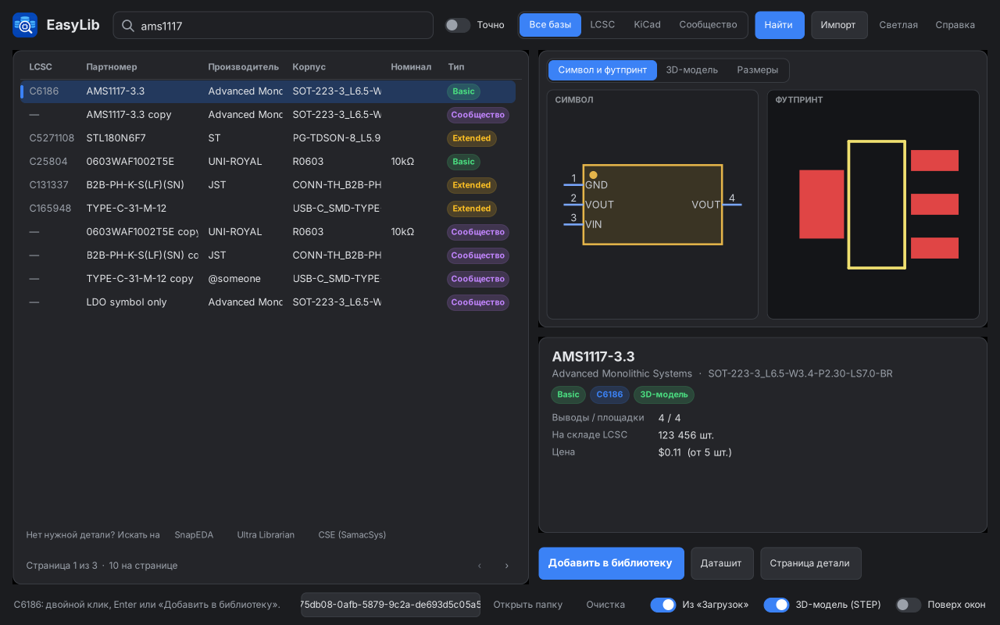
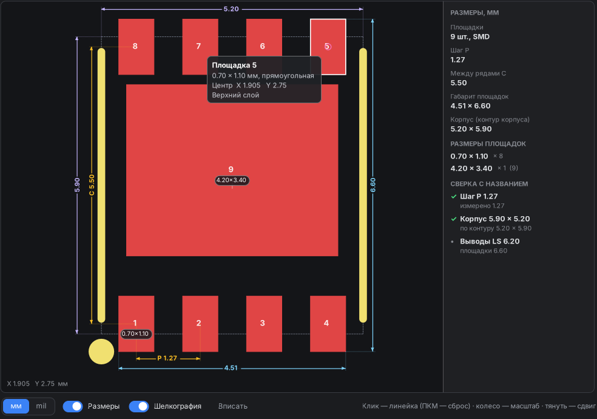

# EasyLib для Altium Designer

Программа ищет электронные компоненты в открытых базах (LCSC, EasyEDA, KiCad), подхватывает файлы со SnapEDA / Ultra Librarian / CSE и складывает их — символ, футпринт, 3D — прямо в библиотеку Altium. Внутри Altium ничего настраивать не нужно.

## Быстрый старт

1. Скачай архив из [**Releases**](../../releases), распакуй и запусти `EasyLib.exe` (Windows 10/11 + интернет).
2. Найди деталь — по номеру LCSC (`C6186`), партномеру (`AMS1117-3.3`) или описанию (`10k 0603`).
3. Нажми «Добавить в библиотеку» — в папке `Документы\EasyLib` появятся `EasyLib.SchLib` и `EasyLib.PcbLib`.
4. Подключи их в Altium один раз: Components → ≡ → **File-based Libraries Preferences** → **Installed** → **Install** → выбери оба файла.
5. Таскай детали на схему из панели Components.

После добавления новых деталей жми в Altium **Components → ≡ → Refresh** — он держит библиотеку в памяти и сам не перечитывает файл.



## Что умеет

- Ищет сразу в нескольких базах: LCSC/JLCPCB, EasyEDA (Сообщество), KiCad.
- Импортирует скачанные файлы со SnapEDA, Ultra Librarian и CSE (`.IntLib` или KiCad) — сам находит их в «Загрузках».
- Показывает деталь до добавления: символ, футпринт, 3D, класс Basic/Extended.
- Проверяет размеры футпринта — габариты, шаг, площадки, сверка с названием, линейка по площадкам.
- Показывает наличие и цену в LCSC, ЧИП и ДИП, Промэлектронике.
- Чистит библиотеку: что сколько весит, удаление лишнего и тяжёлых 3D, с резервными копиями.
- Тёмная тема.



## Откуда берутся детали

| База | Как | Что внутри |
|---|---|---|
| **LCSC / JLCPCB** | поиск | Сотни тысяч продающихся деталей, наличие, цена, Basic/Extended. |
| **EasyEDA (Сообщество)** | поиск | Пользовательское — модули, редкие разъёмы. Никем не проверено. |
| **KiCad** | поиск | ~23 тысячи аккуратных символов со стандартными корпусами. |
| **SnapEDA / UL / CSE** | импорт файла | Миллионы деталей по партномерам. Нужен свой бесплатный аккаунт. |

Сам со SnapEDA/UL/CSE программа ничего не выкачивает — скачиваешь под своим аккаунтом, EasyLib подхватывает готовый файл.

## О чём помнить

- **Сверяй футпринт с даташитом перед заказом плат.** В LCSC и EasyEDA бывают ошибки, детали «Сообщества» вообще никто не проверял. Вкладка «Размеры» помогает, но даташит не заменяет.
- Поиск EasyEDA/LCSC и наличие в магазинах работают через их обычные интерфейсы без публичного API — могут в любой момент измениться и отвалиться до обновления программы.
- Русские названия внутри Altium пишутся транслитом — так устроен формат.
- Интерфейс пока только на русском.

## Планы

- Поиск по SnapEDA прямо в списке (через их официальный API).
- Обновление уже добавленной детали без «удали и добавь заново».
- Добавление списком из BOM, экспорт BOM и файла расстановки для JLCPCB.
- Английский интерфейс.

Нашёл баг или хочешь фичу — [Issues](../../issues) открыты, приложи номер детали и скриншот.

## Собрать самому

```bat
build.bat
```

Нужен только Windows, компилятор C# входит в .NET Framework. Тесты — `tests/run_tests.sh` (нужен Python).

## Лицензия

[MIT](LICENSE). По сторонним компонентам — [NOTICE.txt](NOTICE.txt). EasyLib не связан с Altium, EasyEDA, LCSC, JLCPCB, KiCad, SnapEDA, Ultra Librarian и SamacSys.

---

Весь код написан на вайб-кодинге нейросетью и построчно человеком не вычитывался. Баги возможны — см. раздел выше.
